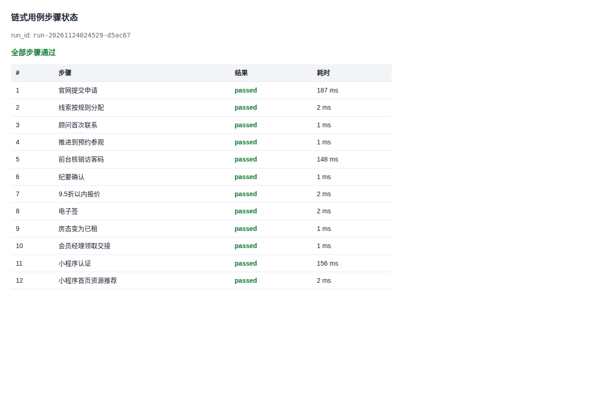

# 招商闭环 12 步链式端到端用例

一条 pytest 用例把一个客户从**官网留资**走到**小程序首月推荐**的 12 个跨系统步骤串起来，
失败时给出「哪一步、什么错误、请求 trace、已建数据 ID、失败截图」，运行结束按 `run_id`
清理干净。

- 语言/框架：Python 3.11+ · pytest · Playwright（真浏览器）· FastAPI（被测参考桩）
- 小程序：Playwright 驱动 H5 认证页（默认）/ `miniprogram-automator`（可选，需微信开发者工具）
- 全部数据虚构，无真实个人信息、无客户名称



## 1. 快速开始

```bash
python3 -m venv .venv
.venv/bin/pip install -r requirements.txt
.venv/bin/playwright install chromium     # 首次需下载浏览器
.venv/bin/pytest -q                       # 期望 5 passed
```

一键脚本（建 venv + 装依赖 + 跑用例）：

```bash
bash run_tests.sh
```

## 2. 12 步与接口映射

| # | 步骤 | 触发方式 | 接口 / 页面 | 关键断言 |
|---|------|----------|-------------|----------|
| 1 | 官网提交申请 | **浏览器** | `GET/POST /apply` | 返回 `app-*`、`lead-*`，线索状态 `assigned` |
| 2 | 线索按规则分配 | HTTP | `GET /api/crm/leads/{id}` | `assigned_to` 命中顾问池，分配序号递增 |
| 3 | 顾问首次联系 | HTTP | `POST /api/sales/leads/{id}/contact` | 状态→`contacted`，`first_contact_at` 落库 |
| 4 | 推进到预约参观 | HTTP | `POST /api/sales/leads/{id}/visit` | 状态→`visit_scheduled`，发 6 位访客码 |
| 5 | 前台核销访客码 | **浏览器** | `GET/POST /desk/verify` | 状态→`visited`，访客码只能核销一次 |
| 6 | 纪要确认 | HTTP | `POST /api/sales/leads/{id}/minutes` | 状态→`minutes_confirmed`，纪要留痕 |
| 7 | 9.5 折以内报价 | HTTP | `POST /api/sales/leads/{id}/quotes` | 实付 = 标准 × 0.95；折扣 >9.5 折返回 422 |
| 8 | 电子签 | HTTP | `POST /api/contracts/esign` | 两方签署完成；拒签返回 422 `ESIGN_REJECTED` |
| 9 | 房态变为已租 | HTTP | `GET /api/site/rooms/{id}` | 房态 `vacant→rented`，绑定合同 |
| 10 | 会员经理领取交接 | HTTP | `POST /api/ops/handovers` | 状态→`claimed`，房态仍为 `rented` |
| 11 | 小程序认证 | **浏览器** | `GET/POST /mini/login` | 会员落库 `mb-*`，绑定线索 |
| 12 | 小程序首页资源推荐 | HTTP | `GET /api/mini/home/recommendations` | 首月推荐 ≥ 1 条 |

浏览器步（1/5/11）由真实 Chromium 驱动，其余走真实 HTTP；两者共用同一个 `run_id`。

## 3. 验收标准对照

| AC | 判定 | 复现命令 | 期望输出 |
|----|------|----------|----------|
| AC1 12 步链连跑 5 次全过、平均 ≤10 min | 5 次 `ok=True`，12/12 步通过 | `.venv/bin/python scripts/run_5x.py` | `all_passed=True  avg=< 1.1s` |
| AC2 电子签拒签时报告指出失败步骤并附 trace/截图 | `failed_step="电子签"`（第 8 步），trace 含 422 与异常栈，截图落盘 | `.venv/bin/pytest tests/test_chain.py::test_ac2_esign_rejection_reports_step_and_trace -q` | `1 passed` |
| AC3 结束后该 run_id 数据清理、查询为 0 | 独立第二 HTTP 客户端复查 `total=0` | `.venv/bin/pytest tests/test_chain.py::test_ac3_run_data_purged_after_run -q` | `1 passed` |
| AC4 跳过小程序两步后其余 10 步照常通过 | 2 步 `skipped`、10 步 `passed`、整链 `ok=True` | `SKIP_MINI=1 .venv/bin/pytest tests/test_chain.py::test_ac4_skip_mini_mode_runs_remaining_10_steps -q` | `1 passed` |
| 附加：报价护栏 9.5 折 | 折扣 <9.5 折被拒 | `.venv/bin/pytest tests/test_chain.py::test_quote_beyond_95_percent_is_rejected -q` | `1 passed` |

实测数据（本机 WSL / Chromium 159，见 `reports/run_report.md`）：

| 次序 | 结果 | 通过步数 | 链耗时 | 残留数据 |
|------|------|----------|--------|----------|
| 1–5 | 全部 ✅ | 12/12 | 1.00 s ~ 1.04 s | 0 |
| 平均 | — | — | **0.99 s** | **0** |

## 4. 交付产物

| 文件 | 内容 |
|------|------|
| `reports/step_duration_report.md` | 步骤耗时报告样例（12 步逐项 + 占比） |
| `reports/step_duration_report_skip_mini.md` | SKIP_MINI 模式下的耗时报告样例（10 步） |
| `reports/failure_report_esign.md` | 电子签拒签失败报告样例（步骤名 + trace + 截图 + 数据 ID） |
| `reports/run_report.md` | 运行报告（5 连跑汇总 + AC 对照） |
| `reports/chain_5x_summary.json` | 5 连跑机器可读汇总 |
| `reports/report_ac1_single.json` 等 | 每次运行的完整 JSON 报告 |
| `reports/artifacts/*.png` | 失败截图（Playwright 自动抓取） |
| `docs/screenshots/*.png` | 官网申请页、前台核销页、全绿步骤表 |

重新生成报告与截图：

```bash
.venv/bin/pytest -q && .venv/bin/python scripts/run_5x.py
.venv/bin/python scripts/make_reports.py
.venv/bin/python scripts/capture_walkthrough.py
```

## 5. 失败即停与报告结构

单次运行产出 JSON：

```json
{
  "run_id": "run-20261122192106-ac8df7",
  "ok": false,
  "failed_step": "电子签",
  "failed_step_index": 8,
  "error": "HTTPStatusError: 422 ESIGN_REJECTED",
  "trace": [{"method": "POST", "path": "/api/contracts/esign", "status": 422, "body": "{...}"},
            {"traceback": "..."}],
  "screenshot": "reports/artifacts/failure_step8_ac8df7.png",
  "data_ids": {"application_id": "app-...", "lead_id": "lead-...", "quote_id": "q-..."},
  "steps": [{"index": 1, "name": "官网提交申请", "status": "passed", "duration_ms": 203.4}, "..."],
  "cleanup": {"removed": 9},
  "counts_after_cleanup": {"application": 0, "total": 0}
}
```

失败后**不再继续执行**后续步骤，直接进收尾：按 `run_id` 清库并复查。

## 6. 小程序两步：驱动与跳过

| 模式 | 启用方式 | 行为 |
|------|----------|------|
| H5（默认） | `MINI_DRIVER=playwright-h5` | Playwright 驱动会员端认证表单，本机可复现 |
| 真小程序 | `MINI_DRIVER=miniprogram-automator` | `mini/automator_verify.js` 连微信开发者工具自动化端口 |
| 跳过 | `SKIP_MINI=1` 或 `ChainRunner(skip_mini=True)` | 第 11/12 步记 `skipped`，10 步照跑 |

> `miniprogram-automator` 路径需要微信开发者工具（已登录 + 服务端口开启），
> **本仓 CI 环境不具备，因此该路径未做真机验证**；失败会抛明确异常，不会静默降级。

## 7. 接真实平台要改哪里

本仓 `app/` 是**接口约定一致的参考桩**，不是客户平台。切换真实环境：

1. 把 `ChainRunner(base_url=...)` 指向真实网关（或用环境变量 `E2E_BASE_URL`）。
2. 对照真实接口调整 `chain/runner.py` 里的路径与字段名（映射表见第 2 节）。
3. 删除/隔离 `app/` 与 `/api/_test/*`、`/_diag/*`（仅测试用的状态注入与清理端点，
   **生产环境必须不注册**）。
4. 若小程序侧走真机，设置 `MINI_DRIVER=miniprogram-automator` 与 `WX_DEVTOOLS_CLI`。

## 8. 目录结构

```
sales-funnel-e2e/
├── app/                # 参考桩：api.py（接口）/ store.py（内存库）/ harness.py（起服务）
├── chain/              # runner.py（12 步 + 报告）/ mini_driver.py（小程序驱动）
├── mini/               # automator_verify.js（真小程序执行器）
├── tests/              # conftest.py / test_chain.py（AC1–AC4 + 报价护栏）
├── scripts/            # run_5x.py / make_reports.py / capture_walkthrough.py
├── reports/            # 报告样例 + JSON + 失败截图
├── docs/screenshots/   # 页面截图
├── requirements.txt
└── run_tests.sh
```

## 9. 数据与合规

- 所有企业、联系人、房源均为**虚构测试数据**（`虚构会员企业-<run 尾号>`、`13800000000`）。
- 不含真实个人信息 / 客户名称；不引入向境外传输数据的第三方 SDK。
- 每次运行以 `run_id` 隔离，结束后软删除 + 物理清理，库内残留 0 条。

## 许可

MIT，见 `LICENSE`。可自由使用、修改、再分发，保留版权声明即可。
