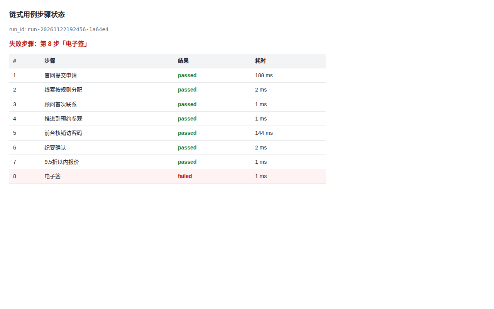

# 失败注入报告样例：电子签拒签

注入方式：`ChainRunner(..., esign_reject=True)`（等价于电子签桩返回 422 ESIGN_REJECTED）。

| 项 | 值 |
|----|----|
| 结论 | **失败（预期）** |
| 失败步骤 | **第 8 步「电子签」** |
| 错误 | `AssertionError: esign -> 422 {"error":{"code":"ESIGN_REJECTED","message":"signer rejected the contract (injected)","step":"电子签"}}` |
| 已执行步数 | 8（失败即停，第 9–12 步未执行） |
| 收尾 | run_id 数据已清理，残留 0 条 |

## 失败点之前的步骤

| # | 步骤 | 结果 | 耗时 (ms) | 占比 |
|---|------|------|-----------|------|
| 1 | 官网提交申请 | passed | 188.0 | 20.6% |
| 2 | 线索按规则分配 | passed | 1.5 | 0.2% |
| 3 | 顾问首次联系 | passed | 1.2 | 0.1% |
| 4 | 推进到预约参观 | passed | 1.2 | 0.1% |
| 5 | 前台核销访客码 | passed | 144.0 | 15.8% |
| 6 | 纪要确认 | passed | 1.8 | 0.2% |
| 7 | 9.5折以内报价 | passed | 1.4 | 0.2% |
| 8 | 电子签 | failed | 1.4 | 0.2% |
| — | **合计（12 步 + 收尾）** | failed | **911.7** | 100% |

## 该步的请求 trace

### 请求 1：`POST /api/contracts/esign` → 422

- 耗时：1.4 ms
- 响应体：

```json
{"error":{"code":"ESIGN_REJECTED","message":"signer rejected the contract (injected)","step":"电子签"}}
```
### 异常栈（尾部）

```
Traceback (most recent call last):
  File "chain/runner.py", line 92, in _exec
    fn()
  File "chain/runner.py", line 194, in s8_esign
    self.expect(r.status_code == 200, f"esign -> {r.status_code} {r.text[:200]}")
  File "chain/runner.py", line 86, in expect
    raise AssertionError(message)
AssertionError: esign -> 422 {"error":{"code":"ESIGN_REJECTED","message":"signer rejected the contract (injected)","step":"电子签"}}

```

## 失败截图



> 截图为运行时 Playwright 打开的步骤状态页，红框行为失败步骤「电子签」。

## 本次运行已创建的数据 ID（用于回溯清理）

| 实体 | ID |
|------|----|
| run_id | `run-20261122192456-1a64e4` |
| application_id | `app-2159790f7ba6` |
| lead_id | `lead-961ef5e04f8a` |
| assigned_to | `sp-bob` |
| visit_id | `visit-5d544c895b0a` |
| checked_in_visit_id | `visit-5d544c895b0a` |
| quote_id | `quote-79622fc096ea` |

## 判读

报告在**步骤名 + HTTP 状态 + 业务错误码 + 异常栈**四个层面同时指出「电子签」这一环，
不是笼统的「链路失败」；trace 内 `ESIGN_REJECTED` 可直接对应到电子签桩的拒签分支。
